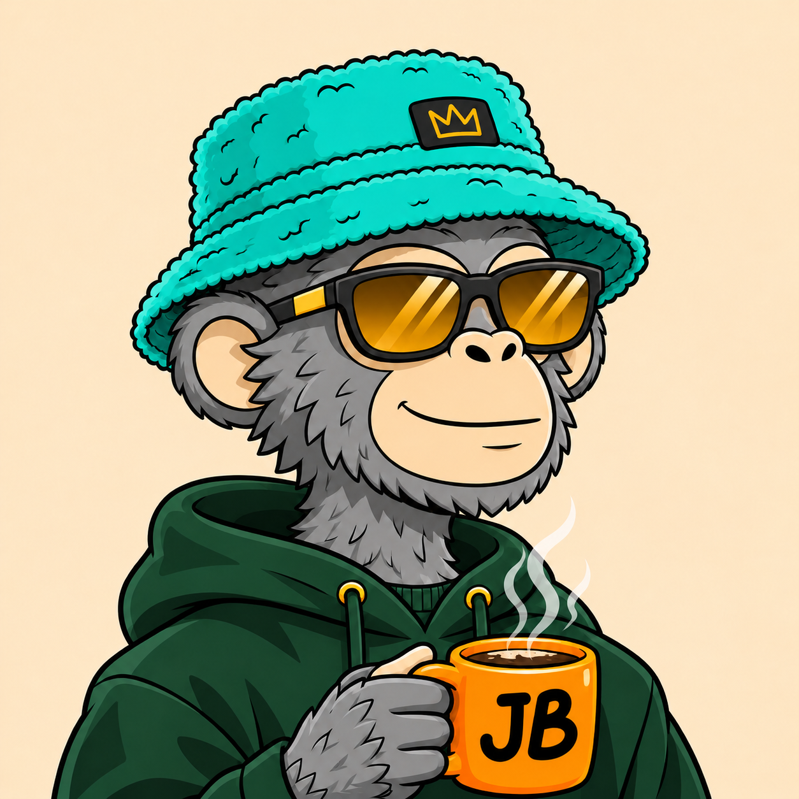
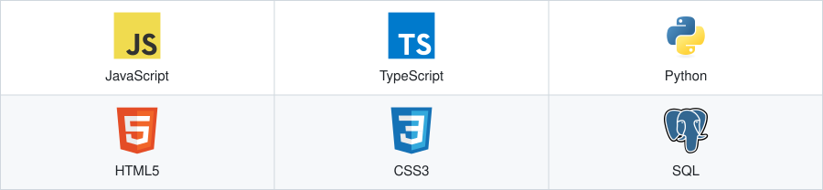
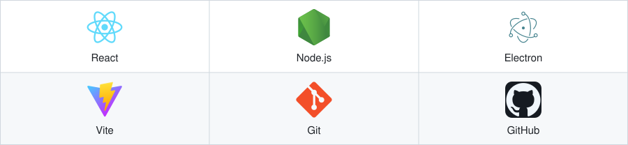
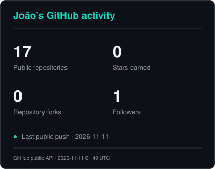
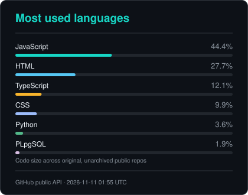

  

  <h1>Hi there, I’m João Barreto 👋</h1>

  
<strong>Software development · Automation · Curious about AI</strong>

  
Self-taught developer in Viseu, Portugal. I learn by building practical tools for everyday problems.

## 👨‍💻 About Me

I started programming to simplify the work I was doing in customer support. Today, I work mainly with JavaScript, Node.js and Electron, and keep learning through real projects.

### What I’m building

- **[Workflow automation](https://github.com/Barreto-JB/slack-8x8-autofill)** — A browser extension that captures information and fills repetitive workflows.
- **[Barreto English Journey](https://github.com/Barreto-JB/barreto-english-journey)** — A progressive English study platform built with React, TypeScript and Supabase.
- **[Registo Cais](https://github.com/Barreto-JB/registo-cais)** — A web application for logging entries and exits, with export and offline support.

I’m interested in AI, useful integrations and tools that give people more time for the work that matters.

## 💻 Languages and Tools

Technologies used in my public projects and development workflow.

### 👨‍💻 Programming & Markup Languages

<picture>
  <source media="(max-width: 900px) and (prefers-color-scheme: dark)" srcset="assets/technology-languages-dark-mobile.svg" />
  <source media="(max-width: 900px) and (prefers-color-scheme: light)" srcset="assets/technology-languages-light-mobile.svg" />
  <source media="(prefers-color-scheme: dark)" srcset="assets/technology-languages-dark.svg" />
  
</picture>

### 🗄️ Databases & Cloud Hosting

<picture>
  <source media="(max-width: 900px) and (prefers-color-scheme: dark)" srcset="assets/technology-databases-dark-mobile.svg" />
  <source media="(max-width: 900px) and (prefers-color-scheme: light)" srcset="assets/technology-databases-light-mobile.svg" />
  <source media="(prefers-color-scheme: dark)" srcset="assets/technology-databases-dark.svg" />
  
</picture>

### 🛠️ Software & Tools

<picture>
  <source media="(max-width: 900px) and (prefers-color-scheme: dark)" srcset="assets/technology-tools-dark-mobile.svg" />
  <source media="(max-width: 900px) and (prefers-color-scheme: light)" srcset="assets/technology-tools-light-mobile.svg" />
  <source media="(prefers-color-scheme: dark)" srcset="assets/technology-tools-dark.svg" />
  
</picture>

## 📊 GitHub Profile Stats

  <picture>
    <source media="(prefers-color-scheme: dark)" srcset="https://raw.githubusercontent.com/Barreto-JB/Barreto-JB/output/github-stats.svg" />
    <source media="(prefers-color-scheme: light)" srcset="https://raw.githubusercontent.com/Barreto-JB/Barreto-JB/output/github-stats-light.svg" />
    
  </picture>
  <picture>
    <source media="(prefers-color-scheme: dark)" srcset="https://raw.githubusercontent.com/Barreto-JB/Barreto-JB/output/top-languages.svg" />
    <source media="(prefers-color-scheme: light)" srcset="https://raw.githubusercontent.com/Barreto-JB/Barreto-JB/output/top-languages-light.svg" />
    
  </picture>

Cards refresh daily from GitHub’s public API. Language shares reflect code size across original, unarchived public repositories. [View the latest refresh](https://github.com/Barreto-JB/Barreto-JB/actions/workflows/profile-stats.yml).

## 🌱 Goals for 2027

- [ ] 🎓 Start my Computer Engineering degree
- [ ] 🧠 Master Data Structures & Algorithms
- [ ] 📚 Complete 5 professional tech courses
- [ ] 🚀 Build and launch 5 real-world projects
- [ ] 📱 Publish my first Android application
- [ ] 💻 Complete the #100DaysOfCode challenge
- [ ] ☁️ Build my first SaaS application
- [ ] 🛠️ Create my first open-source developer tool
- [ ] 🌍 Contribute to 10 open-source projects
- [ ] 📈 Reach 100+ GitHub contributions
- [ ] ⭐ Reach 100 GitHub stars

<h2 align="center">🤝 Connect with Me</h2>

  
  
  
  

  <picture>
    <source media="(prefers-color-scheme: dark)" srcset="https://raw.githubusercontent.com/Barreto-JB/Barreto-JB/output/github-contribution-snake-dark.svg" />
    <source media="(prefers-color-scheme: light)" srcset="https://raw.githubusercontent.com/Barreto-JB/Barreto-JB/output/github-contribution-snake.svg" />
    
  </picture>

Learning, building and sharing along the way. João Barreto

